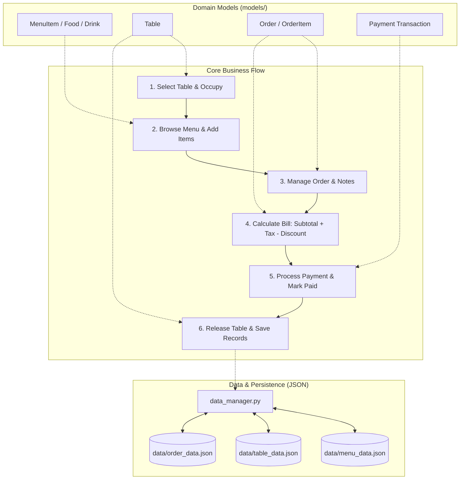

# 🍽️ Restaurant Point of Sale (POS) System
### Group 2 — Generation 6 (Software Engineering)

A modular, object-oriented Python Restaurant Point of Sale (POS) system designed for dine-in operations, itemized ordering, table tracking, billing/payment processing, and persistent data management.

---

## 👥 Team Structure & Role Allocation

| Member | Role | Primary Modules & Responsibilities | GitHub Handle |
| :--- | :--- | :--- | :--- |
| **Kim Sorng** | **Team Lead & Coordinator** | **Order Management System** (`models/order.py`), System Architecture, Repository Coordination, Integration Interfaces | `@kimsorngDev` |
| **Ra Daro** | **Core Developer** | **Menu & Table Management** (`models/menu.py`, `models/table.py`), Initial JSON Persistence Engine | `@RaDaro9999` |
| **Team Member 3** | **Core Developer** | **Payment & Billing System** (`models/payment.py`), Multi-method Payments (Cash, Card, KHQR), Change/Receipts | *Assigned* |
| **Team Member 4** | **Core Developer** | **POS Terminal & Reporting** (`main.py`, `reporting.py`), Interactive CLI/UI Loop, End-of-Day Sales Reports | *Assigned* |

---

## 🏗️ System Architecture & Workflow

The POS system operates on decoupled, single-responsibility modules coordinated through well-defined contracts:



---

## 🔗 Module Integration Contracts

### 1. Menu Module ➡️ Order Module
* **Reference**: `models/menu.py` ➡️ `models/order.py`
* **Snapshot Pricing Pattern**: When a customer orders a menu item, `OrderItem` captures the `item_id`, `name`, and `unit_price` at that instant. This ensures that any future price modifications in the master menu do not retroactively alter closed or open orders.
* **API Interface**:
  ```python
  # Add item directly by MenuItem instance with custom notes
  order.add_item(menu_item, quantity=2, special_notes="Less spicy")
  
  # Duplicate items with identical notes automatically merge quantities
  order.add_item(menu_item, quantity=1, special_notes="Less spicy") # Quantity becomes 3
  ```

### 2. Table Module ➡️ Order Module
* **Reference**: `models/table.py` ➡️ `models/order.py`
* **Table Synchronization**: Each active order is assigned a `table_number`.
  - When an order is opened: `table.occupy()` marks the table as `🔴 Occupied`.
  - When the bill is settled or cancelled: `table.release()` marks the table as `🟢 Available`.

### 3. Order Module ➡️ Payment Module
* **Reference**: `models/order.py` ➡️ Payment System
* **Billing Calculation**: The Order module provides accurate financial figures:
  ```python
  subtotal = order.get_subtotal()
  tax = order.calculate_tax(tax_rate=0.10)              # e.g. 10% VAT
  discount = order.calculate_discount(discount_percent=5.0)  # e.g. 5% Member discount
  final_total = order.calculate_total(tax_rate=0.10, discount_percent=5.0)
  ```
* **Settlement Contract**:
  - The payment module collects payment and generates a transaction reference (e.g. `TXN-1003-CASH`).
  - Upon successful payment:
    ```python
    order.mark_as_paid(payment_reference="TXN-1003-CASH")
    # Order status transitions from 'Pending' / 'In Progress' -> 'Paid'
    ```

### 4. Persistence Layer (`data_manager.py`)
All domain objects support round-trip JSON serialization via `.to_dict()` and `.from_dict()`:
* `save_menu_to_file(menu_list)` / `load_menu_from_file()`
* `save_tables_to_file(tables_list)` / `load_tables_from_file()`
* `save_orders_to_file(orders_list)` / `load_orders_from_file()`

---

## 🌿 Git Workflow & Team Collaboration Rules

To ensure smooth collaboration across all team members and avoid conflicts on `main`:

### 1. Branch Strategy
* `main` is protected — only stable, tested code is merged into `main`.
* Every feature or module development MUST take place on a separate feature branch:
  - `feature/menu-table-management` (Completed by Ra Daro)
  - `feature/order-management` (Completed by Kim Sorng)
  - `feature/payment-module` (Assigned to Payment developer)
  - `feature/pos-terminal-reporting` (Assigned to Terminal/Reporting developer)

### 2. Step-by-Step Contribution Workflow
```bash
# 1. Pull the latest main updates
git checkout main
git pull origin main

# 2. Create your feature branch
git checkout -b feature/your-feature-name

# 3. Work on your files and test thoroughly
python your_test_script.py

# 4. Stage your changes and commit using Conventional Commits
git add .
git commit -m "feat(order): implement Order and OrderItem classes with tax calculations"

# 5. Push branch to GitHub
git push -u origin feature/your-feature-name

# 6. Create a Pull Request (PR) on GitHub targeting 'main'
# Request at least one peer review before merging.
```

### 3. Commit Message Standards
Use clear semantic prefixes:
* `feat:` A new feature or class
* `fix:` A bug fix
* `docs:` Documentation updates
* `refactor:` Code improvements without functionality changes
* `test:` Adding or updating test cases

---

## 📁 Repository Directory Layout

```text
Restaurant_Point_of_Sale_-POS-_System_Group2_Gen6/
│
├── .github/
│   └── PULL_REQUEST_TEMPLATE.md  # Standard PR checklist for the team
├── .gitignore                    # Prevents __pycache__, logs, and venvs from being tracked
├── README.md                     # Central project and team guide
│
├── data/
│   ├── menu_data.json            # Master menu catalog (JSON)
│   ├── table_data.json           # Restaurant table layouts & status (JSON)
│   ├── order_data.json           # Persisted customer orders (JSON)
│   ├── sample_data.py            # Initial seed data for dev and tests
│   └── __init__.py
│
├── models/
│   ├── __init__.py               # Exports MenuItem, Food, Drink, Table, Order, OrderItem
│   ├── menu.py                   # MenuItem, Food, Drink domain models
│   ├── table.py                  # Table domain model
│   └── order.py                  # Order and OrderItem domain models
│
├── data_manager.py               # JSON storage & retrieval engine with error handling
├── order_manager.py              # Staff Order Management Service (Start, Add, Remove, Update, Subtotal, Summary, Validate)
├── menu_table.py                 # Menu and Table test & verification script
└── order_test.py                 # Order management & integration test suite
```

---

## 🛠️ Staff Order Management Operations (`order_manager.py`)

Staff interact with customer orders using the dedicated service functions:

| Operation | Function | Description |
| :--- | :--- | :--- |
| **Start Order** | `start_new_order(order_type, table_number, notes, tables_list)` | Starts a **Dine-In** (requires valid & vacant table, auto-occupies) or **Takeaway** order. |
| **Add Items** | `add_menu_item_to_order(order, item, quantity, special_notes, menu_list)` | Adds items by `MenuItem` instance or by integer `item_id`. Merges duplicate lines. |
| **Remove Items** | `remove_item_from_order(order, item_id)` | Removes line items matching `item_id`. |
| **Update Quantity** | `update_item_quantity(order, item_id, new_quantity)` | Updates line item quantity (removes if quantity set to 0). |
| **Calculate Subtotal** | `calculate_subtotal(order)` | Computes current order subtotal before taxes/discounts. |
| **Display Summary** | `display_order_summary(order, tax_rate, discount_percent)` | Prints and returns formatted customer receipt summary. |
| **Checkout Validation** | `validate_order_for_checkout(order)` | Ensures order has at least 1 item before allowing billing/settlement. |

---

## 🚀 Getting Started & Testing

### Prerequisites
* Python 3.10 or higher (Python 3.13 tested)

### Running the Test Suites

1. **Test Menu and Table Management**:
   ```bash
   python menu_table.py
   ```

2. **Test Order Management & Inter-module Integration**:
   ```bash
   python order_test.py
   ```
   *Validates input validation, snapshot pricing, duplicate item grouping, discount/tax calculations, payment simulation, table release, and JSON storage persistence.*

---

## 📋 Next Milestones
- [x] Menu & Table Management Module (`models/menu.py`, `models/table.py`)
- [x] Initial Order & OrderItem Classes with Persistence (`models/order.py`, `data_manager.py`)
- [x] Module Interconnection Contracts (Menu ↔ Order ↔ Table ↔ Payment)
- [x] Shared Repository Configuration (`.gitignore`, `README.md`, PR Templates)
- [ ] Payment & Receipt Generation Module (`models/payment.py`)
- [ ] Interactive POS Terminal CLI Loop (`main.py`)
- [ ] Sales Reporting & Analytics (`reporting.py`)
