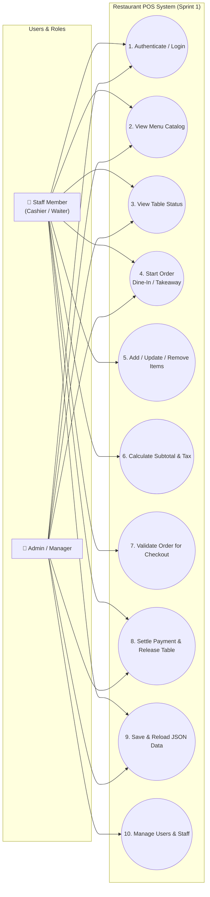
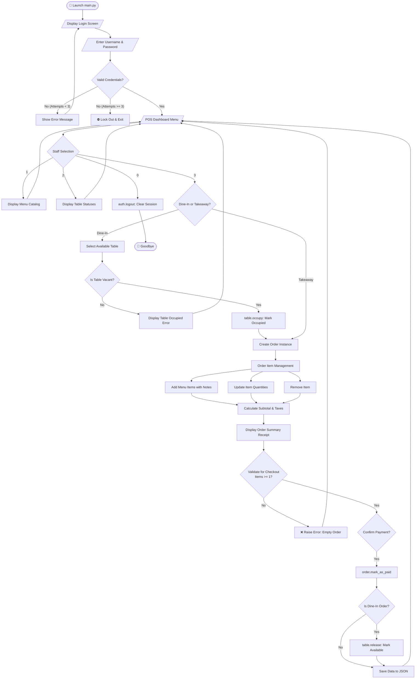

# 🍽️ Restaurant Point of Sale (POS) System
### Group 2 — Generation 6 (Software Engineering)

A modular, object-oriented Python Restaurant Point of Sale (POS) system designed for dine-in operations, takeaway orders, itemized ordering, table status tracking, billing/payment processing, staff authentication, and persistent JSON data management.

---

## 📊 Sprint 1 Status & Compliance Report

### Deliverables Checklist
- [x] **Project folder and file structure**: Modular separation into `models/`, `data/`, service managers, and executable runners.
- [x] **Basic login screen**: Implemented in [auth_manager.py](file:///d:/Python/POS/Restaurant_Point_of_Sale_-POS-_System_Group2_Gen6/auth_manager.py) and interactive entry in [main.py](file:///d:/Python/POS/Restaurant_Point_of_Sale_-POS-_System_Group2_Gen6/main.py) with SHA-256 hashed password verification and role-based access.
- [x] **Menu data and menu display**: Master catalog in `data/menu_data.json`, domain models in `models/menu.py`, and formatted display utility in `menu_table.py`.
- [x] **Table data and table display**: Table records in `data/table_data.json`, `Table` model in `models/table.py`, and occupancy status tracking.
- [x] **Initial Python classes**: `MenuItem`, `Food`, `Drink`, `Table`, `Order`, `OrderItem`, and `User`.
- [x] **System flowchart and use-case diagram**: Fully documented below with Mermaid diagrams.
- [x] **Shared repository with the initial code**: Configured with `.gitignore`, PR templates, and test verification scripts.

### Completion Criteria Checklist
- [x] **The project can run without errors**: Verified with `main.py --demo`, `order_test.py`, and `menu_table.py`.
- [x] **The team has agreed on the system requirements**: Formalized Functional & Non-Functional specifications documented below.
- [x] **Menu items and tables can be displayed**: Formatted console outputs with emoji tags, pricing, and availability states.
- [x] **The main classes have been created**: All core domain models implemented with validation and serialization.
- [x] **The project structure is ready for the next sprint**: Ready for Sprint 2 (Payment Gateways, Advanced Reporting, and Graphical UI).

---

## 👥 Team Structure & Role Allocation

| Member | Role | Primary Modules & Responsibilities | GitHub Handle |
| :--- | :--- | :--- | :--- |
| **Kim Sorng** | **Team Lead & Coordinator** | **Order Management & Auth** (`models/order.py`, `models/user.py`, `auth_manager.py`, `main.py`), System Architecture, Repository Coordination | `@kimsorngDev` |
| **Ra Daro** | **Core Developer** | **Menu & Table Management** (`models/menu.py`, `models/table.py`), Initial JSON Persistence Engine | `@RaDaro9999` |
| **Team Member 3** | **Core Developer** | **Payment & Billing System** (`models/payment.py`), Multi-method Payments (Cash, Card, KHQR), Change/Receipts | *Assigned* |
| **Team Member 4** | **Core Developer** | **POS Terminal & Reporting** (`reporting.py`), Shift Reconciliation, Sales Analytics | *Assigned* |

---

## 📋 Agreed System Requirements Specification

### Functional Requirements (FR)
* **FR-01 (Authentication)**: The system must provide a login screen requiring username and password before granting access. Passwords must be securely verified.
* **FR-02 (Role-Based Access)**: Staff accounts must support roles (`Admin`, `Cashier`, `Waiter`).
* **FR-03 (Menu Catalog)**: The system must display food and beverage items with item IDs, names, categories, special tags (Vegetarian, Cold/Hot), and formatted pricing.
* **FR-04 (Table Management)**: The system must display table seat capacities and live statuses (`Available` vs `Occupied`). Tables must automatically occupy when dine-in orders open, and release when orders are settled.
* **FR-05 (Order Types)**: The system must support both **Dine-In** (linked to dining tables) and **Takeaway** (no table required).
* **FR-06 (Order Item Management)**: Staff must be able to add menu items with special instructions, remove items, and adjust quantities. Duplicates with identical notes must automatically merge quantities.
* **FR-07 (Billing & Validation)**: The system must calculate accurate subtotals, configurable taxes (default 10%), and discounts. An order **must contain at least one item** before checkout can proceed.
* **FR-08 (Data Persistence)**: Menu, table, order, and user records must be persisted in JSON format and support error handling.

### Non-Functional Requirements (NFR)
* **NFR-01 (Modularity)**: High cohesion and loose coupling between Menu, Table, Order, Auth, and Persistence modules.
* **NFR-02 (Robustness & Validation)**: Negative numbers, invalid statuses, invalid IDs, and missing keys must be intercepted with custom exceptions (`ValueError`, `try-except`).
* **NFR-03 (Snapshot Pricing)**: Historical orders must lock in the price at order time so future catalog adjustments do not alter past bills.
* **NFR-04 (Traceability)**: Every order must carry a unique ID, timestamp, and status.

---

## 📐 System Use-Case Diagram



---

## 🔄 End-to-End System Process Flowchart



---

## 🔑 Default Staff Credentials (Demo & Testing)

| Username | Plain Password | Role | Description |
| :--- | :--- | :--- | :--- |
| `admin` | `admin123` | **Admin** | Full system administration and manager access |
| `cashier` | `cashier123` | **Cashier** | Checkout, payment processing, and billing |
| `waiter` | `waiter123` | **Waiter** | Table service, ordering, and menu lookup |

---

## 📁 Repository Directory Layout

```text
Restaurant_Point_of_Sale_-POS-_System_Group2_Gen6/
│
├── .github/
│   └── PULL_REQUEST_TEMPLATE.md  # Standard PR checklist for the team
├── .gitignore                    # Excludes __pycache__, logs, and venvs
├── README.md                     # Central project, architecture, and sprint report
│
├── data/
│   ├── menu_data.json            # Master menu catalog (JSON)
│   ├── table_data.json           # Restaurant table layouts & status (JSON)
│   ├── order_data.json           # Persisted customer orders (JSON)
│   ├── user_data.json            # Staff accounts & password hashes (JSON)
│   ├── sample_data.py            # Initial seed data for dev and tests
│   └── __init__.py
│
├── models/
│   ├── __init__.py               # Exports MenuItem, Food, Drink, Table, Order, OrderItem, User
│   ├── menu.py                   # MenuItem, Food, Drink domain models
│   ├── table.py                  # Table domain model
│   ├── order.py                  # Order and OrderItem domain models
│   └── user.py                   # User domain model with SHA-256 password hashing
│
├── auth_manager.py               # Staff authentication & login session manager
├── data_manager.py               # JSON storage & retrieval engine with error handling
├── order_manager.py              # Staff Order Management Service (Start, Add, Remove, Update, Subtotal, Summary, Validate)
├── menu_table.py                 # Menu and Table test & verification script
├── order_test.py                 # Order management & integration test suite
└── main.py                       # Main interactive POS terminal entry point
```

---

## 🚀 Execution & Verification

### 1. Interactive Terminal Application (Login + Full POS Workflow)
```bash
python main.py
```
*Launches the interactive staff login screen and full POS dashboard.*

### 2. Automated Sprint 1 Demonstration (Non-Interactive)
```bash
python main.py --demo
```
*Runs an end-to-end check of authentication, menu/table displays, order creation, item addition, subtotal calculation, and checkout validation without blocking on user input.*

### 3. Unit & Integration Test Suites
```bash
python menu_table.py   # Verifies Menu & Table validation and persistence
python order_test.py   # Verifies Order workflow, Dine-In/Takeaway, and checkout validation
```
